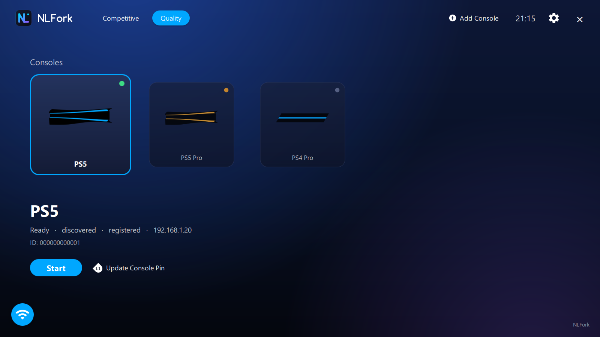
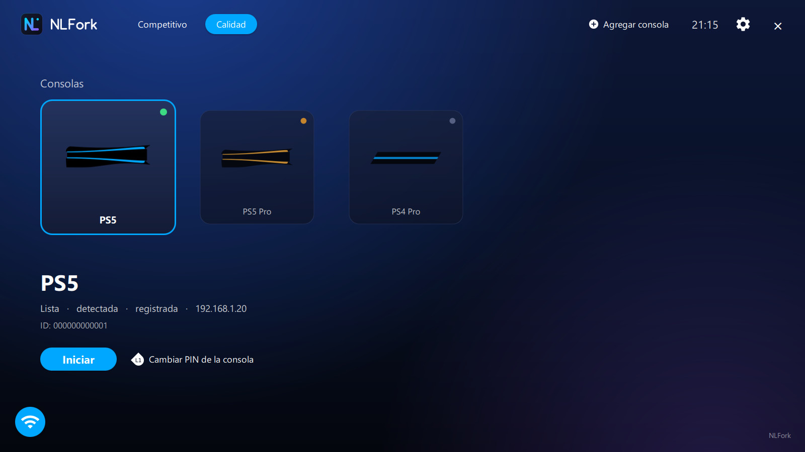

  

  <b>PS5 Remote Play for Windows: lower latency, sharper image, no stutter.</b> 
  <i>Cliente de PS5 Remote Play para Windows: menos lag, imagen más nítida y sin tirones.</i>

  
  
  

  <a href="#english">English</a> · <a href="#español">Español</a>

  

---

## English

**NLFork** is a fork of [chiaki-ng](https://github.com/chiaki-ng/chiaki-ng), the open-source PlayStation Remote Play client. It focuses on three things: input lag, image quality and smooth streaming on Windows. I built it to play my PS5 (and soon GTA VI) on a 1440p PC monitor.

### Download
1. Get **`NLFork-…-windows-x64.zip`** from the [latest release](https://github.com/CrisBuen/NLFork/releases/latest).
2. Extract the **whole** zip and run `NLFork.exe`.
3. If Windows SmartScreen appears, click **More info → Run anyway**. The exe is not code-signed; all the source code is in this repository.

### What NLFork adds to chiaki-ng
| | What it does |
|---|---|
| **One-click profiles** | **Competitive**: lowest latency at 40 Mbps. **Quality**: 100 Mbps with FSRCNNX upscaling, soft CAS sharpening and a chroma shader. |
| **No stutter at high bitrate** | The UDP receive buffer is raised to 4 MB. Without it, 100 Mbps bursts overflowed the socket and caused unrecoverable frame losses (FEC failures). |
| **Hitch detector** | Tells you whether each stutter came from the **network**, the **PC** (decoder or render stalls) or the **controller** (input polling delays). |
| **Live stats overlay** | Ping, Mbps, packet loss, lost frames, network hitches and PC hitches. Toggle it from the stream menu with **Stats**. |
| **Auto-reconnect** | Up to 3 retries when the stream drops because of a network error. It never wakes a console from rest mode. |
| **Freeze fix after 10.7 days of uptime** | On Windows, the monotonic clock overflowed after about 10.7 days without a reboot and froze the video for good. Fixed in NLFork. |
| **`color-nitido` chroma shader** | Luma-guided 4:2:0 chroma reconstruction: about 2 dB closer to the 4:4:4 original, for about 0.05 ms of GPU time. |
| **Console-style UI** | Big console tiles and one-click profiles on the home screen. |
| **Spanish translation** | The language switches instantly, without a restart. |

### Requirements
- Windows 10/11 (64-bit) and a Vulkan-capable GPU.
- A PS5 with Remote Play enabled, on the same network as the PC. A wired connection is strongly recommended.
- If your monitor is not HDR, use the **H265** codec, not **H265 HDR**.

### Building from source
NLFork builds with MSYS2 (MINGW64), exactly like chiaki-ng. See [README-chiaki-ng.md](README-chiaki-ng.md) and the [chiaki-ng docs](https://chiaki-ng.github.io/chiaki-ng/).

---

## Español

  

**NLFork** es un fork de [chiaki-ng](https://github.com/chiaki-ng/chiaki-ng), el cliente libre de PlayStation Remote Play. Se enfoca en tres cosas: menos input lag, mejor imagen y un streaming estable en Windows. Lo hice para jugar mi PS5 (y pronto GTA VI) en un monitor de PC de 1440p.

### Descarga
1. Baja **`NLFork-…-windows-x64.zip`** desde la [última versión](https://github.com/CrisBuen/NLFork/releases/latest).
2. Descomprime el .zip **completo** y abre `NLFork.exe`. Dentro está `LEEME.txt`, con todos los pasos.
3. Si aparece "Windows protegió tu PC", pulsa **Más información → Ejecutar de todas formas**. El programa no tiene firma digital; todo el código está aquí.
4. Para ponerlo en español: **Ajustes → Language → Español**.

### Qué agrega a chiaki-ng
- **Perfiles de un clic**:
  - **Competitivo**: la menor latencia, a 40 Mbps.
  - **Calidad**: 100 Mbps, escalado FSRCNNX, nitidez CAS suave y color más fino.
- **Sin tirones a bitrate alto**: el búfer de red de 4 MB evita las pérdidas de frames que había a 100 Mbps.
- **Detector de tirones**: dice si cada tirón vino de la **red**, del **PC** o del **mando**.
- **Estadísticas en pantalla**: ping, Mbps, pérdida de paquetes, tirones de red y tirones del PC. Se activan con el botón **Estadísticas** del menú del stream.
- **Reconexión automática**: hasta 3 intentos si se cae la red. Nunca enciende la consola si está en reposo.
- **Corrección del congelamiento** que ocurría tras 10,7 días con el PC encendido: el reloj de Windows se desbordaba.
- **Shader `color-nitido`**: el color queda unos 2 dB más cerca del original y cuesta unos 0,05 ms de GPU.
- **Interfaz estilo consola** y **español** con cambio de idioma al instante.

### Requisitos
- Windows 10/11 de 64 bits y una GPU con Vulkan.
- PS5 con Remote Play activado, en la misma red que el PC. Mejor con cable.
- Si tu monitor no es HDR, usa el códec **H265**, no **H265 HDR**.

---

## Credits / Créditos

- [chiaki-ng](https://github.com/chiaki-ng/chiaki-ng): Street Pea and contributors.
- [Chiaki](https://git.sr.ht/~thestr4ng3r/chiaki): Florian Markl.

NLFork is licensed under the **GNU AGPL-3.0**, like chiaki-ng (see [COPYING](COPYING) and [LICENSES](LICENSES)).

NLFork is not affiliated with Sony Interactive Entertainment or Rockstar Games. "PlayStation" and "PS5" are trademarks of Sony Interactive Entertainment. "Grand Theft Auto" is a trademark of Take-Two Interactive.
